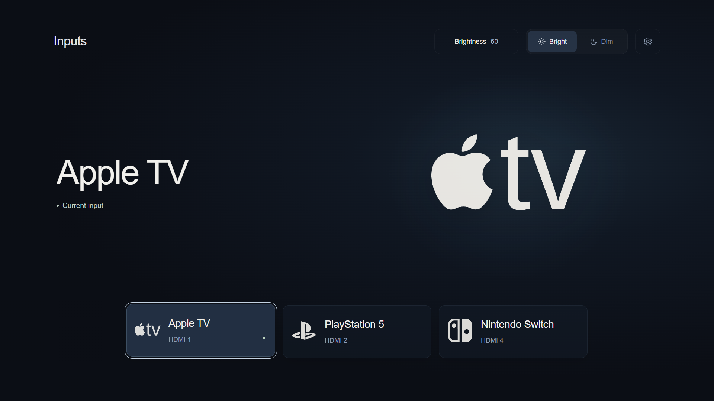
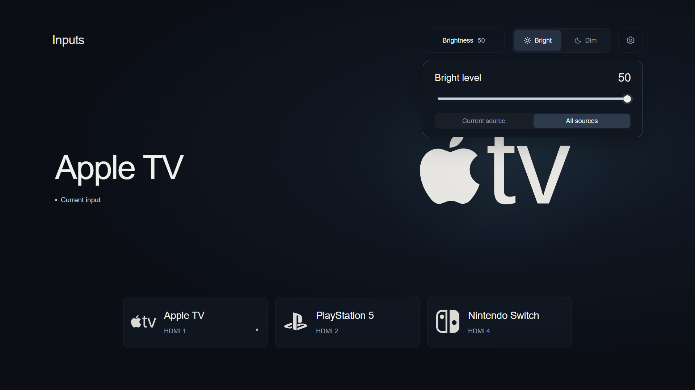

# Cove

A lightweight, native HDMI launcher for Samsung Tizen TVs.



*Offline preview with sample devices. [See the gallery](docs/screenshots.md).*

## Features

- Connected inputs, recognizable artwork and a separate current-input indicator.
- Fast remote navigation, a cached Home screen and direct Samsung Settings.
- Live brightness, including supported Game Mode contexts.
- Two shared, customizable **Bright / Dim** levels that leave the native picture mode selected.
- Local artwork and controls, with no web engine, accounts, cloud dependency or network requests from the renderer.

This is an experimental integration for an exact S90C/Tizen 9 environment, not a
universal Samsung installer. Private APIs and firmware checks limit compatibility.
Read [compatibility](docs/compatibility.md), [validation](docs/remaining-validation.md)
and [recovery](docs/recovery.md) before adapting it.

## Controls

Arrow keys preview inputs; Select opens one. **Current input** marks the source
actually playing. Brightness and profiles always target that source, not a
highlighted card. The cog opens Samsung Settings; Back returns to HDMI.

Bright starts at **50**, Dim at **0**. Select a profile, then adjust Brightness to
customize its shared number. Left/Right applies live; Select or Back closes the
slider and keeps the value. A chosen level follows a different Cove input card
once the destination signal and picture context settle. Home and Back do not
change brightness. See [brightness behavior](docs/brightness.md).



**Current source / All sources** is Samsung's broader Apply Picture Settings
option. Where Samsung restricts it, Cove shows the current scope without a toggle.
Sharing profile numbers does not broadcast settings to every input.

## Development

The renderer is in `src/Cove.Native`; the offline simulator is in `preview`.
Host checks use simulated platform APIs and do not contact a TV.

```text
python -m unittest discover -s tests -p "test_*.py"
dotnet run --project tests/Cove.Controls/Cove.Controls.csproj
dotnet run --project tests/Cove.Bootstrap/Cove.Bootstrap.csproj
dotnet run --project tests/Cove.Presentation/Cove.Presentation.csproj
dotnet run --project tests/Cove.Lifecycle/Cove.Lifecycle.csproj
```

Native compilation requires .NET 6 and matching Samsung framework assemblies
obtained locally; those proprietary files are not distributed:

```text
dotnet build src/Cove.Native/Cove.Native.csproj -c Release -p:TV_FRAMEWORK_DIR=/absolute/path/to/local/tv-framework
```

Run `python scripts/preview.py` and open <http://127.0.0.1:8770/>. Use arrows and
Enter; I opens simulation controls. The preview never connects to a TV.

## Privacy and deployment

Cove's renderer does not disable Samsung telemetry by itself. The separate
[privacy review](docs/privacy-status.md) distinguishes tested component controls
from unresolved shared services. Complete tracking prevention is not established.

The repository contains source, tests, original assets and offline review tools.
It contains no automatic installer, root executor, Samsung binaries, credentials,
TV backups or operational recovery records. Keep the Bixby carrier installed
while it hosts Cove. No open-source license has been selected; third-party
notices remain in [artwork attribution](preview/shared/README.md).
