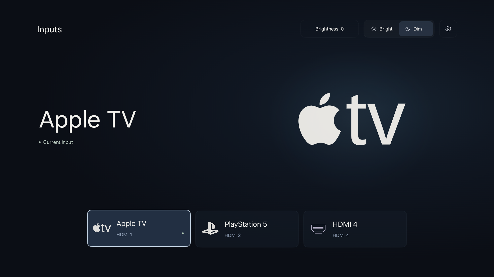
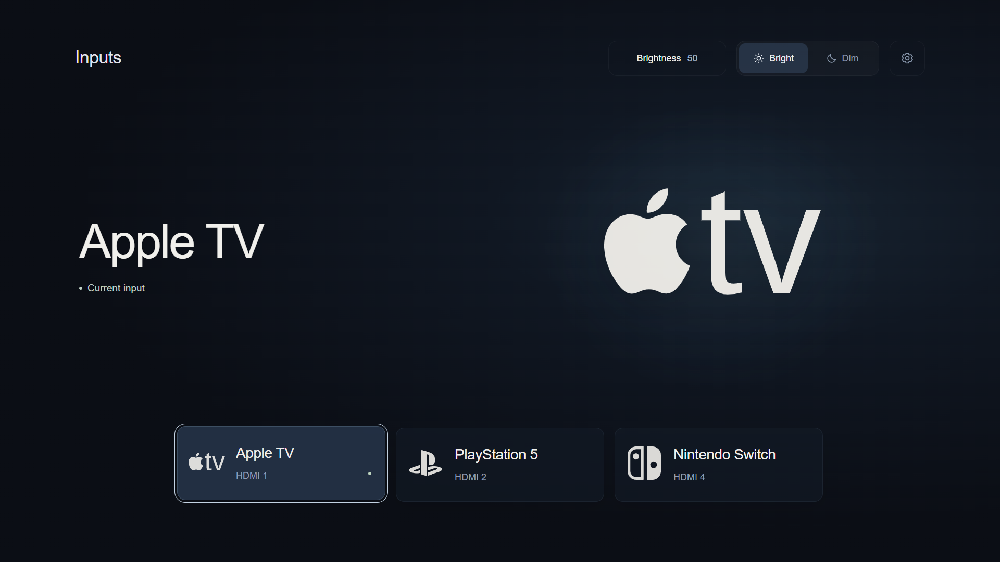
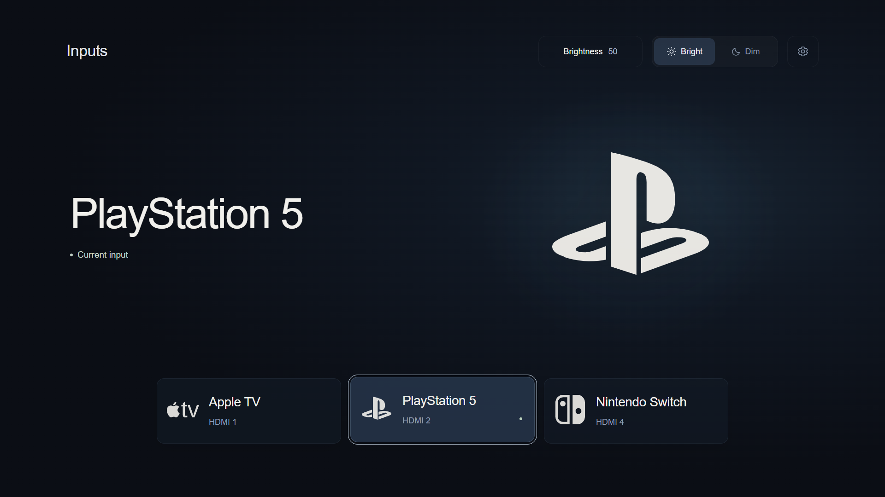
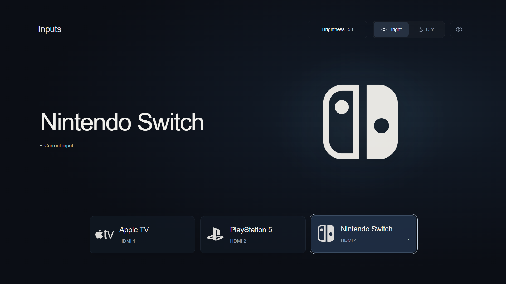
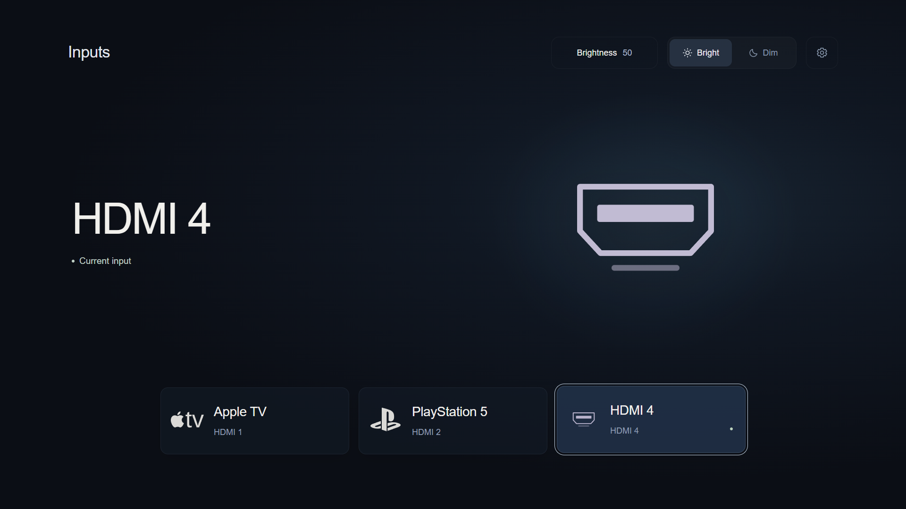
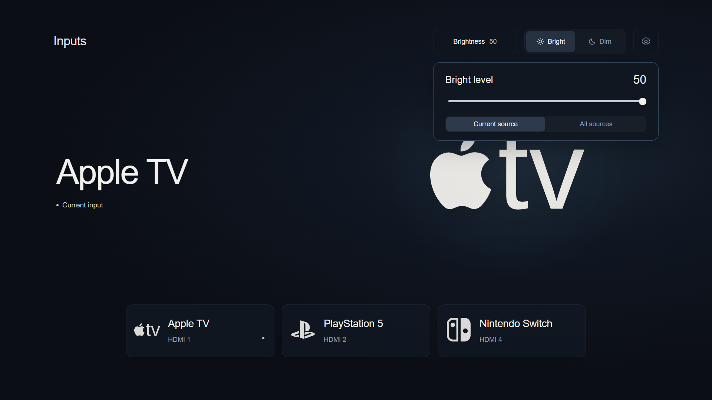
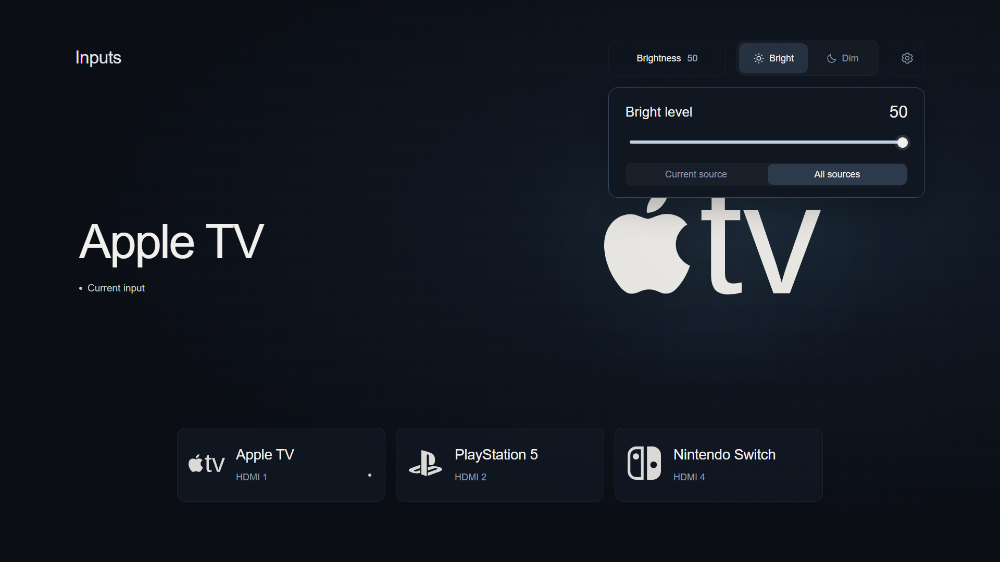
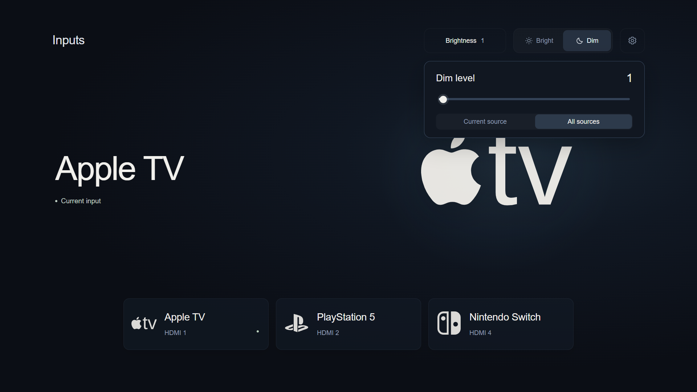
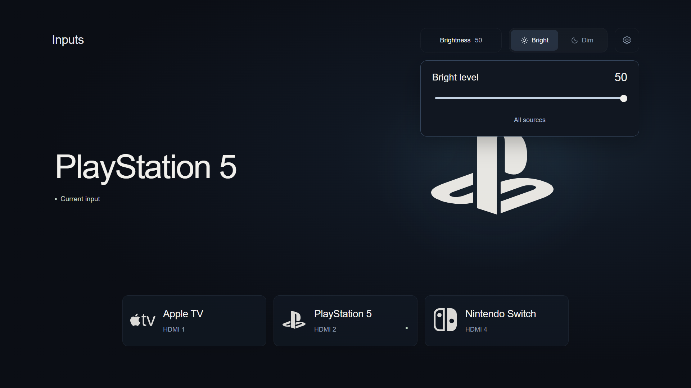

# Launcher gallery

The first image is a native 1920 × 1080 capture from the development TV. The
remaining images are offline browser previews with sample input names and
connections. Screenshots show appearance; they do not establish transition timing
or physical picture and sound.

## On the TV

Actual TV font, input inventory and installed renderer. No media content is captured.

## Browser previews

## Apple TV

## PlayStation 5

## Nintendo Switch

## Unnamed HDMI device

## Brightness: Current source

## Brightness: All sources

The toggle controls Samsung's broader Apply Picture Settings option. A read-only
scope label replaces it when unavailable, as shown in the Game Mode preview.
See [brightness behavior](brightness.md).

## Customize a profile

## Input settling

The ellipsis is temporary while the current picture context is unsettled.
Brightness and profiles become available after valid observations; ordinary
HDMI navigation remains separate. This preview illustrates the state, not the
TV's transition timing.
